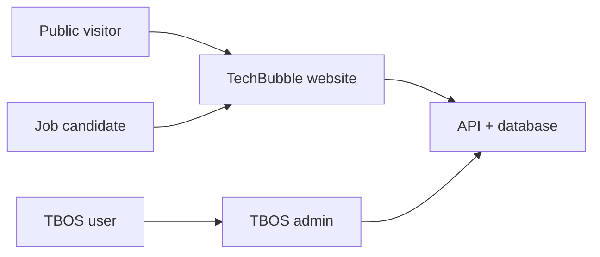

# TechBubble platform overview

This document describes the **public TechBubble website** and **TBOS** (TechBubble Business Operating System), how they fit together, and what each is used for.

## Architecture

One product, four user-facing apps sharing a **PostgreSQL** database and **Express API**:

| Piece | Role |
|--------|------|
| `apps/web` | Public **TechBubble** marketing site (port 3000) |
| `apps/admin` | **TBOS** — internal business operating system (port 3002) |
| `apps/ticketing` | **Client support portal** — tickets for clients and consultants (port 3004) |
| `packages/api` | REST API, auth, uploads, business logic, support ticketing routes (port 3001) |

TBOS, the support portal, and the website call the API. Staff work in TBOS; visitors use the public site; clients and consultants use the support portal.

See [ticketing-portal.md](./ticketing-portal.md) for support portal setup and deployment.

---

## TechBubble public website

**Audience:** Prospects, candidates, and the general public.

**Purpose:** Present TechBubble as an AI / digital transformation company, showcase work, capture leads, and drive **careers** applications.

### Pages and behaviour

- **Home** — Marketing content (editable via TBOS “site pages”), testimonials, job previews, case study highlights.
- **About, Services, Pricing** — Company and offering narrative (CMS-driven where configured).
- **Case studies** — Listing and detail pages from published case studies (categories, banners, rich content).
- **Careers** — Published job listings; apply with resume/documents; applications land in TBOS.
- **Contact** — Form submissions stored and viewable in admin.
- **Legal** — Privacy, terms, cookies.

### Functions

- Read published content from the API.
- SEO-friendly pages.
- File uploads for applications.
- No staff login on the public site.

---

## TBOS (TechBubble Business Operating System)

**Audience:** TechBubble staff (and contractors on limited roles).

**Purpose:** Run **sales**, **delivery**, **recruitment**, and **website content** in one place, with **role-based** navigation.

**Access:** Login (MFA/password policies in Settings), session with inactivity logout, roles such as admin, sales, recruiter, website editor, project manager, and project member.

### Sales module

- **Dashboard** — Pipeline / actuals style metrics (opportunities, contracts, invoices).
- **Clients** — Active/inactive clients, contacts.
- **Opportunities** — Draft → proposal → in progress → accepted/rejected; inline list editing; links to jobs.
- **Contracts** — T&M and fixed price; dates, work units, variations, milestones, activity log, consumed value vs contract.
- **Invoices** — Cross-client invoice list; status and due dates; contract-level invoice create/edit (draft vs issued rules).

### Project management module

- **Projects** — Linked to contracts/clients; estimates vs actuals; members.
- **Timesheets** — Entry and approval workflows (by role).
- **Agreement** (project members) — Sign agreements (e.g. contractor templates with signature capture).

### Recruitment module

- **Dashboard** — Recruitment metrics.
- **Job listings** — CRUD, publish/hot/order, taxonomy (category, tech, department, level), client linkage, **meta tags** and **AI Insights** (match internal profiles to job tags).
- **Career applications** — Pipeline from public careers apply flow.
- **Profiles** — Candidate database, resume text, export, link to jobs/applications.

### Website module (content CMS)

- **Site pages** — Home, about, careers page copy, announcement bar, etc.
- **Case studies, testimonials, FAQs, team** — CRUD and publishing.
- **Contact submissions** — Inbox from the public contact form.
- Job listings overlap with recruitment (website role can manage jobs).

### Settings and admin

- **Taxonomy** — Job categories, technologies, departments, levels; case study categories.
- **Templates** — Credential/agreement HTML (Word import, WYSIWYG, variables, signature blocks).
- **Security** — MFA, password change.
- **Users** — Admin user accounts and roles.

### Cross-cutting TBOS behaviour

Search, filter, and sort on many lists; card vs table views; Excel export in places; file uploads (contracts, invoices, resumes); activity logs on contracts, variations, and projects.

---

## Shared backend

- **Prisma models** for clients, opportunities, contracts, invoices, jobs, applications, profiles, projects, timesheets, templates, site content, users, and related entities.
- **JWT session** for admin (`admin_session` cookie via the Next.js admin app).
- **Public API** for published jobs, case studies, testimonials, contact/careers submit.
- **Object storage or local disk** for documents and images.

---

## How the two sides relate

| Flow | Description |
|------|-------------|
| **Marketing** | TBOS editors publish content → website shows it. |
| **Hiring** | Website careers apply → TBOS recruitment processes applications and profiles. |
| **Revenue** | TBOS sales tracks opportunity → contract → invoice; projects/timesheets support delivery. |
| **Compliance** | Templates and agreement signing support contractor paperwork. |

---

## One-line summary

The **TechBubble website** is the outward-facing brand, content, and careers front door. **TBOS** is the internal system for sales (clients through invoices), projects and timesheets, recruitment (jobs through profiles), and managing what appears on the public site—with one API and database behind both.
